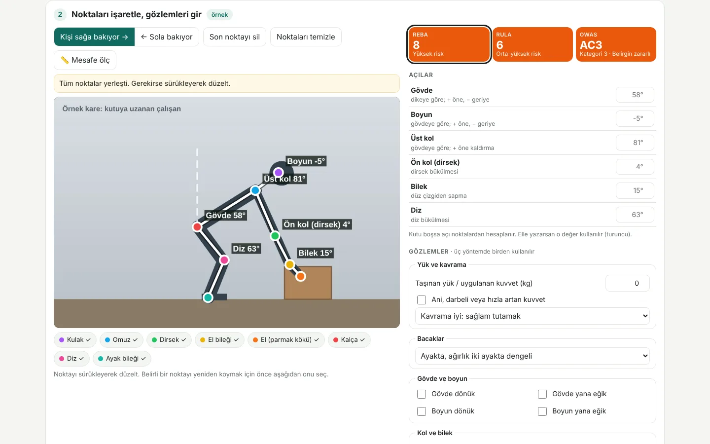
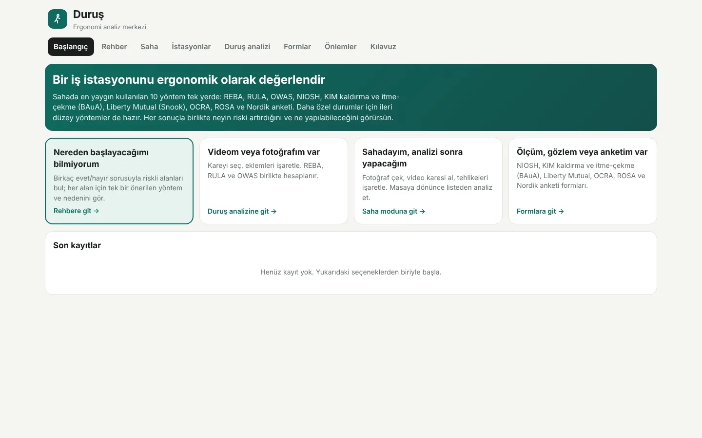

# Duruş — Ergonomi Analiz Merkezi

**Bir iş istasyonunu videodan, fotoğraftan ya da ölçümden ergonomik olarak değerlendiren uygulama. Türkçe ve İngilizce; tarayıcıda ya da Windows masaüstü uygulaması olarak çalışır. Hesap yok.**

- **Web (Türkçe):** https://durus.ysfdurak.com/
- **Web (English):** https://durus.ysfdurak.com/en/
- **Windows masaüstü:** [Sürümler (Releases)](https://github.com/ysfdurak/durus-ergonomi/releases/latest) sayfasından `Durus-…-kurulum.exe` (kurulumlu) ya da `Durus-…-tasinabilir.exe` (kurulumsuz). İnternet gerekmez.

> **English:** Duruş is an ergonomic risk analysis app (REBA, RULA, OWAS, QEC, NIOSH lifting equation, KIM, Liberty Mutual, OCRA, ROSA, Nordic questionnaire and more) with Excel/PDF reports. Use it in the browser at durus.ysfdurak.com/en/ or download the Windows app from Releases. Records stay on your device.

**Kurumda kullanacaksan:** Çalışanların kişisel verisi işlenir. KVKK notları, çalışan duyurusu ve (video projelerinde) çekim öncesi onay şablonu: [docs/KVKK_VE_CALISAN_BILGILENDIRME.md](docs/KVKK_VE_CALISAN_BILGILENDIRME.md).

**Projeyi anlatırken:** Mülakatta sorulabilecek 10 soru, kısa cevaplar ve verilen kararlar (sorun → karar → bedel): [docs/MULAKAT.md](docs/MULAKAT.md).

## Neler var?
- **Sahada en yaygın 11 yöntem tek yerde:** REBA, RULA, OWAS, QEC (Quick Exposure Check — sırt, omuz-kol, el-bilek ve boyun için hızlı tüm vücut taraması), NIOSH kaldırma denklemi, KIM kaldırma-tutma-taşıma ve KIM itme-çekme (BAuA), Liberty Mutual (Snook) itme-çekme-taşıma, OCRA kontrol listesi, ROSA (ofis) ve Nordik kas-iskelet anketi.
- **İleri düzey yöntemler:** LiFFT, DUET, ACGIH el aktivite düzeyi (HAL), Revize Strain Index, ofis iş istasyonu ve çalışma yüksekliği; ortam koşulları için gürültü, titreşim, ısı stresi (WBGT) ve aydınlatma.
- **Duruş analizi:** Video ya da fotoğraftan kare seç; eklemleri **otomatik bul** (MediaPipe Pose, görüntü cihazdan çıkmaz) ya da elle işaretle. Açılar hesaplanır, REBA, RULA ve OWAS aynı anda puanlanır. Görüntü yoksa açılar elle girilebilir. Mesafe ölçümü (kalibrasyon) var.
- **Rehber ve yorum desteği:** Hangi sonucun kullanılacağı, sınıra yakın açılar, girilmemiş yük ve yandan görünmeyen durumlar için uyarılar; kılavuzda sonuçların sınırları ile mevzuat ve sorumluluk bölümleri.
- **Rehber:** Birkaç evet/hayır sorusuyla riskli alanları bulur; her alan için tek bir önerilen yöntemi ve nedenini gösterir.
- **Saha modu:** Sahada fotoğraf çek ya da videodan kare al, tehlikeleri işaretle; analizi masaya dönünce yap.
- **İstasyonlar ve önlemler:** İşyeri, istasyon ve görev yapısı; Fine-Kinney ya da 5×5 matrisle risk değerlendirme tablosu; önlem takibi ve önlem sonrası yeniden ölçüm.
- **Önce–sonra bağı:** Yeniden ölçüm önleme bağlanır: aynı istasyon, görev ve yöntem; aynı tutulan koşullar, önce ve sonra fotoğrafı, yeniden ölçüm tarihi. Kart ve raporlar “tahmini senaryo (ölçüm değil)” ile “sahada yeniden ölçülen iyileşme”yi ayrı etiketler ([ayrıntı](docs/GELISTIRME.md#önce–sonra-bağı-kasım-2026)).
- **Videoyu otomatik tara:** Videonun tamamından belirli aralıklarla kare alıp noktaları otomatik bulur, her kareyi göreve kaydeder; vardiyadaki yüksek riskli süre payı ve zaman grafiği bu karelerden çıkar.
- **Senaryo dene:** Mevcut durumu sabitleyip değerleri değiştir (ör. yük 25 → 15 kg); sonuçlar yan yana karşılaştırılır, beğenilen senaryo tek tıkla önleme dönüşür ve yeniden ölçümde beklenenle karşılaştırılır.
- **Vücut bölgeleri ve iş rotasyonu:** Her görevin boyun, sırt-bel, omuz, dirsek, el-bilek ve bacak bölgelerini ne düzeyde zorladığı vücut figürü ve tabloyla; seçilen görevler için aynı bölgeyi art arda zorlamayan rotasyon sırası ve uyarılar.
- **Maliyet ve geri ödeme:** Kas-iskelet rahatsızlıklarının yıllık maliyeti, önlemlerle beklenen tasarruf, geri ödeme süresi ve 3 yıllık net kazanç.
- **Raporlar ve yedek:** Excel (tüm kayıtlar, görev raporu, tek kayıt değerlendirme formu; vücut bölgeleri, rotasyon planı, maliyet ve geri ödeme sayfaları), PDF rapor (aynı bölümlerle; önlem planında senaryoda beklenen sonuç), CSV; yedek alınmadıysa başlangıçta hatırlatma; tüm kayıtları tek .json dosyasına indirip başka cihazda geri yükleme.

| Başlangıç | Formlar (NIOSH) | Rehber |
|---|---|---|
|  |  |  |

- **İki dil:** Türkçe ve İngilizce; sağ üstteki düğmeyle geçilir, seçim hatırlanır. Tarayıcı dili Türkçe olmayan ziyaretçi ilk girişte İngilizce sürüme yönlendirilir. İki dil aynı kayıtları kullanır.

## Nasıl çalışıyor?
- Tek bir HTML dosyası; sunucu yok. Hesaplar tarayıcıda yapılır.
- Düzenlenen tek kaynak `tools/i18n/source.html` (Türkçe). İngilizce sürüm ve yayındaki `index.html` bu kaynaktan üretilir (ayrıntı: [docs/GELISTIRME.md](docs/GELISTIRME.md)).
- Kayıtlar yalnızca kullanıcının tarayıcısında saklanır (localStorage, fotoğraf ve kareler için IndexedDB). Video ve fotoğraflar hiçbir sunucuya gönderilmez.
- **Dış bağlantı yok:** ExcelJS, pdfmake, MediaPipe Pose (otomatik nokta bulma) ve IBM Plex yazı tipleri depodaki `lib/` klasöründen gelir; CDN'e ya da Google Fonts'a istek gitmez. Sayfadaki güvenlik kuralı (CSP, `connect-src 'self'`) başka adrese bağlantıyı tarayıcı düzeyinde engeller. `lib/` klasörünü `node tools/kutuphaneler.mjs` üretir (sürümler `desktop/package.json`'da sabit); lisans bildirimleri `lib/lisanslar/`.
- **İnternetsiz çalışma:** Web sürümü ilk açılıştan sonra internet olmadan da açılır (`sw.js`). Otomatik nokta bulma dosyaları (~25 MB) ilk kullanımda indirilir, sonra internetsiz de çalışır.
- Sonuçlar karar desteği içindir; bir iş güvenliği uzmanının ya da işyeri hekiminin değerlendirmesinin yerine geçmez.

## Yayın
- Canlı adres **durus.ysfdurak.com**: Cloudflare Workers, `main` dalına her gönderimde otomatik yayın (ayarlar `wrangler.jsonc`, yayın dışı dosyalar `.assetsignore`).
- Kendi bilgisayarında: depo kökünde `python -m http.server 8000`, sonra http://localhost:8000/ (İngilizce: /en/).
- **Masaüstü güncellemeleri:** Uygulama açılışta yeni sürüm olup olmadığını sessizce denetler, varsa indirme sayfasını önerir (Yardım → Güncellemeleri denetle). Kendini değiştirmez; yeni kurulum dosyası kayıtları korur.
- **Masaüstü:** `main`'e gelen her değişiklik Windows dosyalarını yalnızca derler (Actions çıktısı). Herkese açık sürüm, `desktop/package.json` sürümüyle aynı `v1.5.0` gibi yeni bir etiket gönderilince yayımlanır. Yayımlanmış bir sürümün dosyaları sonradan değiştirilmez (ayrıntı: [docs/GELISTIRME.md](docs/GELISTIRME.md)). Elle denemek için: `cd desktop && npm install && npm start`.

## Nasıl yapıldı?
Ürünü, kapsamı ve yöntem seçimini Yusuf Durak belirledi; kod ve içerik yapay zekâ (Claude) ile geliştirildi. İlk sürüm bir claude.ai artifact'ı olarak yapıldı; bu depodaki sürüm bağımsız çalışacak şekilde uyarlandı (dosya indirme tarayıcının kendi indirmesiyle yapılır).

Portföy: https://ysfdurak.com/tr/projeler/durus-ergonomi-analizi/

## Lisans

Bu proje [PolyForm Shield 1.0.0](LICENSE.md) lisansıyla yayınlanır. Kaynak kodu açıktır, ancak resmi anlamda bir "açık kaynak" lisansı değildir.

- **Serbest:** Kişiler, okullar ve şirketler kendi işlerinde ücretsiz kullanabilir, değiştirebilir ve kendi bilgisayarlarına ya da sunucularına kurabilir. İzin almak gerekmez.
- **Yazılı izin gerekir:** Yazılımı satmak, adını değiştirip ürün gibi sunmak ya da bununla (ücretsiz olsa bile) rakip bir ürün veya hizmet sunmak.
- **Garanti yok:** Yazılım olduğu gibi sunulur. Bağlayıcı olan İngilizce lisans metnidir.
- Üçüncü taraf bileşenler kendi lisanslarına tabidir.

Kurumunuzda kullanıyorsanız haber verirseniz sevinirim: kurulumda yardımcı olabilir, kurumunuza özel ihtiyaçları birlikte değerlendirebiliriz. İletişim: iletisim@ysfdurak.com

### License (English)

Released under [PolyForm Shield 1.0.0](LICENSE.md). The source is available, but this is not an OSI "open source" licence.

- **Free:** individuals, schools and companies may use it in their own work, change it and run it on their own computers or servers. No permission needed.
- **Needs written permission:** selling it, rebranding it as a product, or providing a product or service that competes with it (even free of charge).
- **No warranty:** provided as is. The English licence text is binding.
- Third-party components keep their own licences.

Using it in your organisation? I'd be glad to hear from you: I can help with setup and look at your organisation's needs together. Contact: contact@ysfdurak.com
