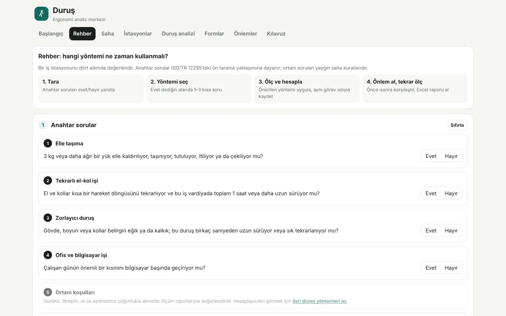

# Duruş — Ergonomi Analiz Merkezi

**Bir iş istasyonunu videodan, fotoğraftan ya da ölçümden ergonomik olarak değerlendiren Türkçe uygulama. Kurulum yok, hesap yok.**

**Dene:** https://durus.ysfdurak.com/

## Neler var?
- **Sahada en yaygın 10 yöntem tek yerde:** REBA, RULA, OWAS, NIOSH kaldırma denklemi, KIM kaldırma-tutma-taşıma ve KIM itme-çekme (BAuA), Liberty Mutual (Snook) itme-çekme-taşıma, OCRA kontrol listesi, ROSA (ofis) ve Nordik kas-iskelet anketi.
- **İleri düzey yöntemler:** LiFFT, DUET, ACGIH el aktivite düzeyi (HAL), Revize Strain Index, ofis iş istasyonu ve çalışma yüksekliği; ortam koşulları için gürültü, titreşim, ısı stresi (WBGT) ve aydınlatma.
- **Duruş analizi:** Video ya da fotoğraftan kare seç, eklemleri işaretle; açılar hesaplanır, REBA, RULA ve OWAS aynı anda puanlanır. Görüntü yoksa açılar elle girilebilir. Mesafe ölçümü (kalibrasyon) var.
- **Rehber:** Birkaç evet/hayır sorusuyla riskli alanları bulur; her alan için tek bir önerilen yöntemi ve nedenini gösterir.
- **Saha modu:** Sahada fotoğraf çek ya da videodan kare al, tehlikeleri işaretle; analizi masaya dönünce yap.
- **İstasyonlar ve önlemler:** İşyeri, istasyon ve görev yapısı; Fine-Kinney ya da 5×5 matrisle risk değerlendirme tablosu; önlem takibi ve önlem sonrası yeniden ölçüm.
- **Raporlar:** Excel (tüm kayıtlar, görev raporu, tek kayıt değerlendirme formu), PDF rapor, CSV ve JSON dışa/içe aktarma.

| Başlangıç | Formlar (NIOSH) | Rehber |
|---|---|---|
|  |  |  |

## Nasıl çalışıyor?
- Tek bir HTML dosyası; sunucu yok. Hesaplar tarayıcıda yapılır.
- Kayıtlar yalnızca kullanıcının tarayıcısında saklanır (localStorage, fotoğraf ve kareler için IndexedDB). Video ve fotoğraflar hiçbir sunucuya gönderilmez.
- Excel ve PDF raporlar için ExcelJS ve pdfmake ilk kullanımda CDN'den (cdnjs, jsDelivr) yüklenir.
- Sonuçlar karar desteği içindir; bir iş güvenliği uzmanının ya da işyeri hekiminin değerlendirmesinin yerine geçmez.

## Yayın
- Canlı adres **durus.ysfdurak.com**: Cloudflare Workers, `main` dalına her gönderimde otomatik yayın (ayarlar `wrangler.jsonc`, yayın dışı dosyalar `.assetsignore`).
- Kendi bilgisayarında: depo kökünde `python -m http.server 8000`, sonra http://localhost:8000/.

## Nasıl yapıldı?
Ürünü, kapsamı ve yöntem seçimini Yusuf Durak belirledi; kod ve içerik yapay zekâ (Claude) ile geliştirildi. İlk sürüm bir claude.ai artifact'ı olarak yapıldı; bu depodaki sürüm bağımsız çalışacak şekilde uyarlandı (dosya indirme tarayıcının kendi indirmesiyle yapılır).

Portföy: https://ysfdurak.com/tr/projeler/durus-ergonomi-analizi/
